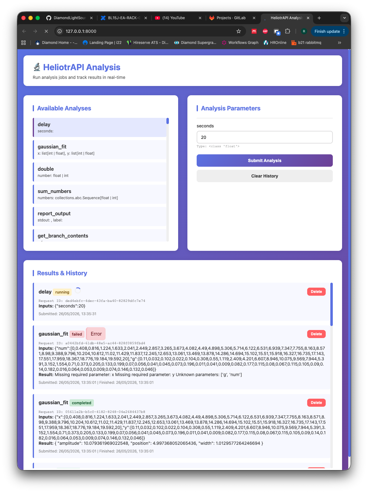

[](https://github.com/DiamondLightSource/heliotrapi/actions/workflows/ci.yml)
[](https://codecov.io/gh/DiamondLightSource/heliotrapi)
[](https://pypi.org/project/heliotrapi)
[](https://www.apache.org/licenses/LICENSE-2.0)

# heliotrapi

An API for small fast data analysis jobs at Diamond Light Source. It is effectively a cloud-native open source FaaS (Function as a Service) platform.

[HEE-LEE-OH-TRAY-PEE-EYE]

Helio - Like the sun, a very brilliant light source.

Heliotrope - An pink-purple indigo-like colour.

HeliotrAPI - The API that comes after blue.

`heliotrapi` exposes an HTTP API to submit analysis jobs, return queued results, and optionally consume messages from RabbitMQ.

Source          | <https://github.com/DiamondLightSource/heliotrapi>
:---:           | :---:
PyPI            | `pip install heliotrapi`
Docker          | `docker run ghcr.io/diamondlightsource/heliotrapi:latest`
Releases        | <https://github.com/DiamondLightSource/heliotrapi/releases>

Example Python usage:

```python
from heliotrapi import __version__

print(f"Hello heliotrapi {__version__}")
```

To start the api server in dev mode on local host:

```bash
uvicorn heliotrapi.main:start_api --reload --factory --host 127.0.0.1 --port 8000

or

heliotrapi serve

```

## Overview

The app accepts analysis jobs via HTTP or the client and stores results in a sqlite database (`results.db_path`) for a configurable time-to-live. On Kubernetes the database lives on a PersistentVolumeClaim, so results survive pod restarts. Jobs can also be ingested from RabbitMQ if `rabbitmq.enabled` is set.

## Sending/Recieving results using the python client

```python

from heliotrapi.client import AnalysisClient

client = AnalysisClient(
    "https://ixx-analysis.diamond.ac.uk",
    username="admin",
    password="password",  # needed to submit analyses, see Authentication below
)

print(client.available_analyses()) #see available analyses

request_id = client.submit("name_of_analysis", examplekwarg1=1, examplekwarg2=2) # <- if kawrgs are invalid it will raise

result = client.get_result() #returns an AnalysisResult basemodel

result = client.get_request_id_result(request_id) #same as above, but specific

print(result)

```

## Sending/Recieving results as an http request

submit jobs to `/analyse` as a json blob via an HTTP POST request

if want to call the function "double" eg:

```python
def double(number: float | int) -> float:
    """Example analysis that doubles a number."""
    return number * 2
```

then the json would be sent as a POST request like:

{"analysis_name": "double", "inputs": {"number": 5}}

the server will handle request_id time and created_at, 
but if you want you can also send it in it's full form 
and create a uuid and timestamp yourself:

{"analysis_name":"double","inputs":{"number":5},"request_id":"d68de927-79f5-4df3-83d9-d125445c758a","created_at":"2026-05-29T11:47:09.087317"}

via curl the example command would be:

```bash
curl -X POST https://ixx-analysis.diamond.ac.uk/analyse -u admin:password -H "Content-Type: application/json" -d '{"analysis_name":"double","inputs":{"number":5}}'
```

and to get the last result from `/results/latest` as a GET request

```bash
curl -X GET https://i15-1-analysis.diamond.ac.uk/results/latest
```

If you are getting redirected due to the a proxy use curl -LX ...

## Authentication

Submitting analyses, streaming, and reading results (`/results/...`) require HTTP Basic auth.
The health check, `/get_analyses` and `/endpoints` are open.

Auth is on by default. Turn it off in the config with:

```yaml
auth:
  enabled: false
```

The username and password are read from the `HELIOTRAPI_USERNAME` and `HELIOTRAPI_PASSWORD`
environment variables. Never put them in a config file. If they aren't set, they default to
`admin` / `password` for local development, and the server logs a warning on startup.
On Kubernetes they come from a SealedSecret, see [Auth credentials](#auth-credentials).

- Python client: pass `username=` and `password=` to `AnalysisClient`
- curl: add `-u username:password`
- WebUI: the browser asks for the username and password when the page loads

Basic auth sends the credentials with every request, so only expose the API over HTTPS.

## Using the WebUI

You can also navigate to the url or the ip address to be met with:



### Request flow

- AnalysisClient submits jobs to `/analyse`
- Jobs are queued in `QueueManager`
- Workers process jobs in FIFO order
- Results are returned via `/results/id/{request_id}` or `/results/latest`
- Optional RabbitMQ listener can enqueue jobs automatically

                     AnalysisClient ─────--────────────────
                        │ ▲                │              │
                        ▼ │                ▼              ▼
        Analysis <-── heliotrapi ──---►  RabbitMQ ──---► Results
           Job   ─---►    ▲                │
                          │                │
                          │                │   
                    RabbitListener <───────

## Using your plugin code

In the config or the helm chart you can changed the following lines:

```yaml
    plugins:
      paths:
        - ./plugins # local folder for plugins
      github_repos: # Https GitHub repos with analysis code (ending with .git), each configured separately
        - url: https://github.com/DiamondLightSource/xrpd-toolbox.git
          register_all: False # read every file in this repo and register every public function
          include: # dotted paths relative to the repo's src; only these are read when register_all is False
            - xrpd_toolbox.i15_1.attenuation # whole module
            # - xrpd_toolbox.i15_1 # whole package
            # - xrpd_toolbox.i15_1.attenuation.my_func # single function
      message_functions: # dotted path (relative to a repo's src) of the one function to run for each STOMP message
        start: null # called with StartMessage fields as kwargs
        stop: null # called with StopMessage fields as kwargs
        nexus_started: null # called with NexusMessage fields as kwargs
        nexus_updated: null # called with NexusMessage fields as kwargs
        nexus_finished: null # called with NexusMessage fields as kwargs
```

In this example plugins will be downloaded and installed to ./plugins. The github repo https://github.com/DiamondLightSource/xrpd-toolbox.git
will be cloned to the .plugins folder.

Each GitHub repo is configured separately with `register_all` and `include`. A repo can also be given as a plain URL string, which reads and registers nothing.

With `register_all: True`, every file in the repo's `src` is read and every public function is added to heliotrapi's available analyses, except those prefixed with `_` or in files prefixed with `_` or `test_`. This is not recommended for production use, but is useful for testing.

With `register_all: False`, only what is listed under `include` is read and registered. Entries are dotted paths relative to the repo's `src` folder, and hyphens are treated as underscores. An entry can point at a package (`xrpd_toolbox.i15_1`), a module (`xrpd_toolbox.i15_1.attenuation`) or a single function (`xrpd_toolbox.i15_1.attenuation.my_func`).

Functions should be strongly typed and return something, e.g.

```python
import math


def my_custom_func(first_number: float, second_number: float) -> float:

    return math.log(first_number) / math.log(second_number)
```

### Message handlers

`message_functions` (under `plugins`, not under a repo) maps each STOMP message type to the dotted path of the single function that runs when that message arrives. The path is relative to a repo's `src` and is looked up across all configured repos.

The function is called with every field of the message model as keyword arguments, so it must accept all of them, either as named parameters or with `**kwargs`:

| key | message model | fields passed as kwargs |
| --- | --- | --- |
| `start` | `StartMessage` | `name`, `doc`, `task_id` |
| `stop` | `StopMessage` | `name`, `doc`, `task_id` |
| `nexus_started` / `nexus_updated` / `nexus_finished` | `NexusMessage` | `status`, `file_path`, `visit_directory`, `swmr_status`, `scan_number`, `scan_dimensions`, `scannables`, `detectors`, `percentage_complete`, `processing_request` |

```python
from heliotrapi.task_queue.message_models import RunStartDoc


def on_start(name: str, doc: RunStartDoc, task_id: str):
    print(doc.scan_file)


def on_nexus_finished(file_path: str, scan_number: int, **kwargs):
    print(file_path, scan_number)
```

```yaml
    plugins:
      message_functions:
        start: xrpd_toolbox.i15_1.handlers.on_start
```

## Kubernetes deployment

This repository includes a Helm chart under `./helm/heliotrapi`.

### Config support

The service supports configuration from one of these sources:

- `CONFIG_PATH` environment variable
- mounted config file at `/etc/config/config.yaml`
- local `config.yaml` file in the current working directory

In Kubernetes, the Helm chart mounts `config.yaml` from a `ConfigMap` and sets:

```yaml
env:
  - name: CONFIG_PATH
    value: "/etc/config/config.yaml"
```

### RabbitMQ config

The Helm values now expose RabbitMQ settings in the same shape as the app expects:

```yaml
config:
  rabbitmq:
    enabled: true
    host: ixx-analysis.diamond.ac.uk
    username: guest
    password: guest
    port: 61613
    destinations:
      - "/topic/public.worker.event"
      - "/topic/gda.messages.scan"
      - "/topic/gda.messages.processing"
      - "/topic/public.analysis.trigger"
```

### Auth credentials

When `config.auth.enabled` is true (the default), the pod reads `HELIOTRAPI_USERNAME` and
`HELIOTRAPI_PASSWORD` from the Secret named by `authSecretName` (default `heliotrapi-auth`).
Create it with a [SealedSecret](https://dev-guide.diamond.ac.uk/kubernetes/tutorials/secrets/#credential-management)
while logged in to the target cluster and namespace:

```bash
kubectl create secret generic heliotrapi-auth --dry-run=client -o yaml \
  --from-literal=username='<username>' --from-literal=password='<password>' \
  | kubeseal -o yaml > heliotrapi-auth-sealed.yaml

kubectl create -f heliotrapi-auth-sealed.yaml
```

`heliotrapi-auth-sealed.yaml` is encrypted, so it's safe to commit. Never commit the plain Secret.
Create the SealedSecret before deploying - the pod won't start until the Secret exists.

## Helm usage

1. Build and push your Docker image

```bash
podman build -t ghcr.io/diamondlightsource/heliotrapi:latest .
podman push ghcr.io/diamondlightsource/heliotrapi:latest
```

2. Render the chart

```bash
helm template heliotrapi ./helm/heliotrapi
```

3. Dry-run validation

```bash
helm template heliotrapi ./helm/heliotrapi | kubectl apply --dry-run=client -f -
```

4. Install the chart

```bash
helm install heliotrapi ./helm/heliotrapi
```

5. Verify the deployment

```bash
kubectl get pods
kubectl get svc
```

6. Test the API

```bash
kubectl port-forward svc/heliotrapi 8000:8000
```

Then open:

```text
http://localhost:8000/
```

## Example Kubernetes Deployment

Go to the i15-services repo on gitlab.diamond.ac.uk to see an example of how to set it up


## Create a secret:

1. Go to the right cluster and namespace. Do:

```bash
module load k8s-ixx
```

2. Type your password. Nothing shows while you type:

```bash
read -rsp "Password: " PW; echo
```

3. Create the sealed secret (change ixx-heliotrapi to your beamline):

```bash
kubectl create secret generic heliotrapi-auth --dry-run=client -o yaml --from-literal=username='ixx-heliotrapi' --from-literal=password="$PW" | kubeseal -o yaml | kubectl create -f -
```

4. Clear the password from your shell:

```bash
unset PW
```

5. Check it. Both a sealedsecret and a secret should be listed:
```bash
kubectl get sealedsecret,secret heliotrapi-auth
```

6. Now add to the blueapi config:

```
env:
  - name: HELIOTRAPI_USERNAME
    valueFrom:
      secretKeyRef:
        name: heliotrapi-auth
        key: username
  - name: HELIOTRAPI_PASSWORD
    valueFrom:
      secretKeyRef:
        name: heliotrapi-auth
        key: password
```

7. Deploy. Restart the pod. Go to the webpage and use ixx-heliotrapi as the username and your password as the password to see results on the frontend


8?. If you need to delete the secret and re-do it:

```bash
kubectl delete sealedsecret heliotrapi-auth
```
